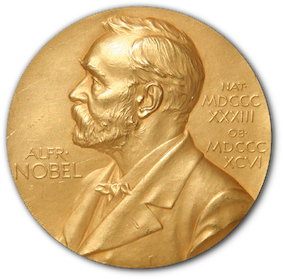

# Visualiser l’histoire des lauréats du prix Nobel

## 1. Présentation du projet

Ce projet propose une exploration et une visualisation de l’histoire des prix Nobel. L’analyse porte sur les personnes et organisations récompensées entre 1901 et 2023, à partir d’un jeu de données issu de l’API du prix Nobel.

L’analyse est réalisée en R dans un notebook Jupyter et utilise principalement `dplyr`, `readr` et `ggplot2`.

## 2. Objectifs

Le notebook cherche notamment à :

- étudier la répartition des lauréats par sexe et par pays de naissance ;
- suivre l’évolution, par décennie, de la proportion de lauréats nés aux États-Unis ;
- comparer la proportion de lauréates selon les décennies et les catégories ;
- identifier la première femme récompensée ;
- repérer les lauréats et organisations ayant reçu plusieurs prix Nobel.

## 3. Source et description des données

Le fichier `data/nobel.csv` contient 999 enregistrements de lauréats ou organisations, couvrant les années 1901 à 2023. Il regroupe les catégories suivantes : physique, chimie, physiologie ou médecine, littérature, paix et sciences économiques.

Les principales colonnes sont :

- `year`, `category` et `prize` : informations sur le prix ;
- `full_name`, `laureate_id` et `laureate_type` : identité du lauréat ;
- `birth_date`, `birth_city`, `birth_country` et `sex` : informations de naissance ;
- `organization_name`, `organization_city` et `organization_country` : informations sur les organisations ;
- `motivation` et `prize_share` : motivation et part du prix ;
- `death_date`, `death_city` et `death_country` : informations de décès lorsqu’elles sont disponibles.

Les données sont présentées comme provenant de l’API officielle du prix Nobel.

## 4. Structure des fichiers

```text
.
├── data/
│   └── nobel.csv          # Données des prix Nobel
├── Nobel_Prize.png        # Illustration utilisée dans le notebook
├── notebook.ipynb         # Analyse et visualisations en R
└── README.md              # Documentation du projet
```

## 5. Prérequis

- R 4.5.0 ou une version compatible ;
- Jupyter Notebook ou JupyterLab ;
- un kernel R (`IRkernel`) ;
- les packages R `readr`, `dplyr` et `ggplot2`.

## 6. Installation

Installer les packages nécessaires depuis R :

```r
install.packages(c("readr", "dplyr", "ggplot2"))
```

Le package `tidyverse` n’est pas indispensable : le notebook utilise uniquement les trois packages ci-dessus. La cellule d’installation du package `ps` présente dans une ancienne exécution du notebook peut être ignorée.

## 7. Exécution du notebook

Depuis la racine du projet, lancer Jupyter :

```bash
jupyter notebook notebook.ipynb
```

Puis sélectionner un kernel R et exécuter les cellules dans l’ordre. Le notebook charge les données avec :

```r
library(readr)
library(dplyr)
library(ggplot2)

nobel <- read_csv("data/nobel.csv", show_col_types = FALSE)
```

Les graphiques sont produits directement dans le notebook avec `ggplot2`.

## 8. Principaux résultats

Les calculs réalisés dans le notebook montrent notamment que :

- les hommes sont majoritaires dans le jeu de données ;
- les États-Unis sont le pays de naissance le plus représenté ;
- la décennie 2000 est celle où la proportion de lauréats nés aux États-Unis est maximale selon le calcul réalisé ;
- entre 1901 et 2000, les catégories `Literature` et `Peace` comptent chacune 12 lauréates ;
- Marie Curie est la première femme lauréate identifiée, en physique ;
- plusieurs lauréats ou organisations apparaissent plusieurs fois, dont Marie Curie, John Bardeen, Frederick Sanger, Linus Pauling, le Comité international de la Croix-Rouge et l’UNHCR.

## 9. Limites et remarques

- Les valeurs manquantes sont conservées dans le fichier original, mais exclues des calculs lorsque la variable concernée est nécessaire à l’analyse.
- Le chemin vers le fichier de données est relatif à la racine du projet ; il est donc préférable d’ouvrir le notebook depuis ce dossier.
- Les résultats dépendent des libellés et des catégories présents dans le fichier CSV.
- Les catégories contenant peu de lauréats peuvent produire des proportions élevées sur une décennie. Il faut donc interpréter les proportions avec prudence et tenir compte du nombre total d’observations.
- Certaines sorties visibles dans le notebook correspondent à une exécution précédente ; relancer les cellules après installation des packages permet de reconstruire les résultats.
